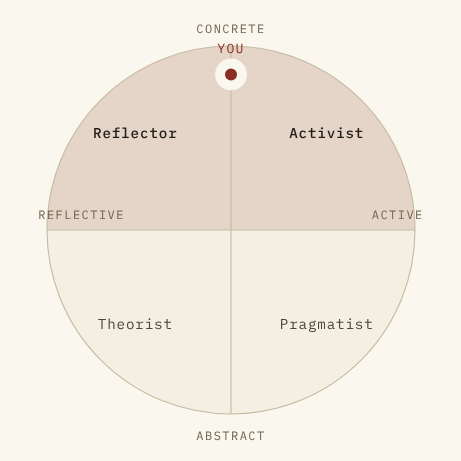
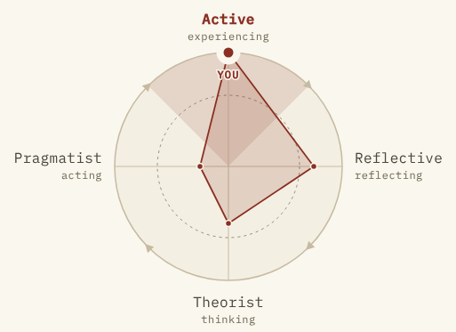

# ELC placement: an evaluation of the tool as it was shipped

Commit evaluated: `1cd74f5` (items version 1.0.0). Written before any of the
fixes. The fixes are tracked in
[`elc-placement-2-content-guide.md`](elc-placement-2-content-guide.md),
which is the independent literature review, and in the commits after it.

## Verdict

The **software** is good and is worth keeping as it is: private, offline,
accessible, bilingual, well tested, and honest about what it is. The
**instrument** at its core has one conceptual error and one measurement
problem. The conceptual error is that it puts Honey & Mumford's four
preferences in the wrong places on Kolb's cycle. The measurement problem is
that six blocks of four statements cannot support a single-location result
of the kind the tool reports. Because of the first error, the diagram, the
placement rule, the axis scores and the floor instructions are all wrong in
the same way. They have to be fixed together.

## What works, and should survive the fix

- **Privacy model.** There is no backend. Results live only in the URL
  fragment, and CI asserts that nothing goes over the network.
- **Accessibility.** Ranking uses native radio groups (no drag), swaps are
  announced in a live region, and the diagram has a full text alternative.
- **i18n discipline.** Every item lives in locale files, the build fails on
  parity drift, and the items carry a version so stale links say so.
- **Display order is shuffled per respondent.** Position carries no weight.
- **Honest copy.** The disclaimer sits above the result, the about page says
  "not validated" in the user's own language, and it cites Pashler et al.
  (2008) and Coffield et al. (2004) on the meshing hypothesis.
- **`ITEMS.md`.** It already flags the weakest items, which is unusual and
  valuable.

## 1. Conceptual issues

### 1.1 The four preferences are drawn as quadrants. They are stages.

In Kolb's experiential learning theory the cycle has **four modes at the
ends of two dialectic axes**. The canonical figure has Concrete Experience
at the top, Reflective Observation on the right, Abstract Conceptualisation
at the bottom and Active Experimentation on the left. The cycle runs
clockwise through them. The *quadrants between* adjacent modes are Kolb's
combined learning styles (Diverging, Assimilating, Converging,
Accommodating).

Honey & Mumford built their four preferences on the **stages**, not on the
quadrants:

| Preference | Stage of the cycle | Kolb mode | Position |
| --- | --- | --- | --- |
| Activist / Active | having an experience | Concrete Experience (CE) | North |
| Reflector / Reflective | reviewing it | Reflective Observation (RO) | East |
| Theorist | concluding from it | Abstract Conceptualisation (AC) | South |
| Pragmatist | planning the next step | Active Experimentation (AE) | West |

The shipped tool places each preference *between* two poles instead
(`QUADRANT_POLES` in `src/model.ts`): Activist = concrete + active,
Reflector = concrete + reflective, and so on. That treats H&M's preferences
as if they were Kolb's combined styles. The result is the diagram the owner
reported: **Activist NE, Reflector NW, Theorist SW, Pragmatist SE**. It is
rotated 45° from the cycle, and mirrored as well, because "Active" sits on
the right where Kolb has Reflective Observation.



### 1.2 The axis scores are computed from the wrong pairs

```
perceiving = (Activist + Reflector) − (Theorist + Pragmatist)
processing = (Activist + Pragmatist) − (Reflector + Theorist)
```

Under the stage model the grasping dialectic is **CE against AC** (Active
against Theorist) and the transforming dialectic is **AE against RO**
(Pragmatist against Reflective). Each shipped axis mixes all four scores,
so every axis score, and the placement read from their signs, measures
something the model does not describe.

### 1.3 The result contradicts its own score table

Placement comes from the signs of those two axes, not from the scores. So:

- **Ranking the Activist statement first in all six sets** (link
  `e1:1.0.0:000000`; scores Activist 24, Reflector 18, Theorist 12,
  Pragmatist 6) is reported as *"exactly on the line between Activist and
  Reflector"*. The respondent with the highest possible Activist score is
  never told "Activist".
- Scores **Activist 17, Theorist 16, Reflector 15, Pragmatist 12** are
  placed in **Reflector**, the third-highest score.
- An exact enumeration over all 24⁶ answer patterns (uniform responding,
  so an upper bound) shows how often this happens. Among people with a
  single top score who are placed in a quadrant, **22.7% are placed in a
  quadrant that is not their highest score**, and **9.7% are placed in
  their third or fourth**.

On the floor, that sends people to stand in a part of the circle their own
numbers do not support.

### 1.4 The diagram does not show a cycle

It is a 2×2 grid inside a ring. There are no stages, no direction and
nothing that says "experience → reflection → conclusions → trying it". The
session is about running the *whole cycle*, so the one picture in the tool
should show it.

### 1.5 Naming

- "Activist" carries a political sense in pt-BR (`Ativista`). `ITEMS.md`
  already flags this. EN "Reflector" and pt-BR "Reflexivo" are also not the
  same kind of word.
- The owner's names, **Active, Reflective, Theorist, Pragmatist** (pt-BR
  *Ativo, Reflexivo, Teórico, Pragmático*), follow the Ibero-American usage
  of the Honey–Alonso CHAEA (*Activo, Reflexivo, Teórico, Pragmático*). In
  Portuguese they are the established terms.
- Under the new orientation, "Active" at **North** sits next to "Active
  Experimentation" at **West**. Every axis label therefore has to name the
  Kolb mode in full ("active experimentation"), never just "active",
  or the two will be confused.

### 1.6 Copy that hard-codes the quadrant model

Each of these needs rewriting, not just renaming:

- the short labels ("Concrete and active");
- the facilitator card's floor instructions ("reflective on the left,
  active on the right");
- the about page ("the quadrant is read off the signs of those two");
- the result sentences for quadrant and edge cases;
- the diagram's text alternative;
- `ITEMS.md`.

## 2. Measurement issues

### 2.1 Too few items

There are six forced-rank blocks, so each preference rests on **six
statements**, and each block decides one sixth of the result. For scale:
the KLSI uses 12 forced-rank sets, and the LSQ and CHAEA use 80 agree/
disagree items (20 per preference). Six is at the floor of what could ever
produce a usable internal consistency, as `ITEMS.md` itself says. Four of
the 24 statements were written to fill a slot.

### 2.2 The result is coarser than it looks

- Scores run from 6 to 24 per preference. With the shipped axes they move
  in steps of 2, so **23.2% of random patterns land exactly on a line and
  1.5% at the centre** (`test/scoring.test.ts` already pins this).
- The close-call band of 3 points was set by judgement and has no basis in
  any estimate of measurement error.
- The diagram shows a single precise-looking dot with no indication of
  uncertainty. The text says "it was close" only when the scores are
  within the band.

### 2.3 Forced ranking makes the scores ipsative

The four scores always total 60. A "high" Theorist score therefore only
means high *relative to the same person's other three*. That is
defensible for "where did *you* lean", which is how the result is worded.
But the floor exercise groups people as if their scores were comparable
across the room, and the copy should not imply more than that.
Conventional reliability and factor analysis are also distorted on
ipsative data, which matters for the pilot plan on the about page
(α ≥ .70 per scale, a four-factor solution).

### 2.4 Item content (beyond what `ITEMS.md` flags)

`ITEMS.md` already flags four problems: Set 3's desirability imbalance, a
likely under-ranking of the Activist items, Theorist/Pragmatist overlap in
Set 1, and four filler items. Two more problems become visible once the
preferences are understood as stages:

- **The Activist items describe *doing*.** "Join in straight away",
  "improvise", "try it and adjust" all describe action. In Kolb's terms
  that is closer to Active Experimentation, the Pragmatist's pole, than to
  Concrete Experience (immersion, involvement with people, the felt
  experience). Under the cardinal model the Active and Pragmatist items may
  load on the same pole.
- **"Before …" framing cross-loads Reflective and Theorist.** "Wait and
  watch", "want to be told what it is for before it starts", "want to
  understand why before I agree" all reward *delay*. A respondent who
  simply dislikes being rushed will score both, whatever their stage
  preference.

### 2.5 Old links after a change of length

Saved links encode one character per set. If the number of sets changes,
an old link fails `scoreResponses(…, expectedSets)` and is shown the
"damaged or made by a newer version" screen. For an *older* link that
message is wrong. It should say the link was made with an earlier edition.

## 3. Visual defects in the diagram

- The quadrant layout, the orientation and the names are as described in
  §1.1 and §1.5.
- At the extremes the **"YOU" label collides with the "CONCRETE" pole
  label** (it is visible in the screenshot above).
- The E/W pole labels sit inside the ring, on top of the wedge fills.
- There is no sign of the cycle's direction.

## What gets fixed, and where

| Issue | Fixed in |
| --- | --- |
| 1.1–1.6, §3 (orientation, naming, placement rule, diagram, copy) | the visual-fix commit |
| 2.1–2.5 and anything the independent review finds in the content | the content commits that implement the guide |

After the visual fix, for the same answers as the screenshot above (Active
first in every set):


