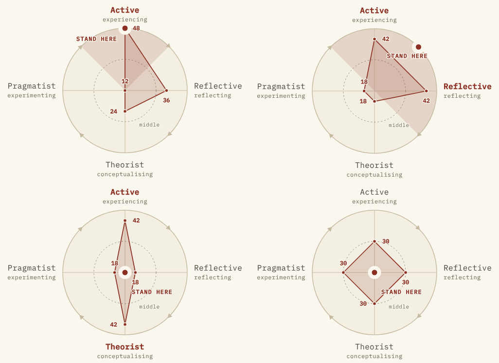

# ELC placement: how the content guide was implemented

This is the third of three records.

1. [`elc-placement-1-evaluation.md`](elc-placement-1-evaluation.md)
   evaluates the tool as shipped and leads to the orientation fix.
2. [`elc-placement-2-content-guide.md`](elc-placement-2-content-guide.md)
   is the independent literature review and its specification.
3. This file says what was implemented, section by section, and where the
   implementation deliberately departs from the guide.

The result is items edition **2.0.0**.

*Left to right, top to bottom: a clear Active result; Active and
Reflective level and ahead (stand on the ring between them); Active and
Theorist level and ahead (stand in the centre); nothing ahead (stand in
the centre).*

## Section by section

| Guide | What it asks | Where it lives now |
| --- | --- | --- |
| §3A model and naming | Stages at the compass points; plain step subtitles; Kolb's terms on the about page only; "modo/ponto" carriers in pt-BR | `src/model.ts` (`PREFERENCES`, `BEARING`, `TENSIONS`); `items.json → preferences` (`name`, `step`, `where`, `description` — A5 verbatim) |
| §3B format, length, blueprint | Forced rank of four, 12 sets, fixed set order, revised instruction | `items.json` (12 sets in S01–S12 order; instruction B2 verbatim); blueprint and writing rules in `ITEMS.md` |
| §3C items | 48 statements, EN + pt-BR; 4 reserve sets for the pilot | `items.json`, parsed straight from the guide's tables so nothing was retyped; reserve sets in `ITEMS.md` |
| §3D scoring | Points 5 − rank; τ = ⌈2√n⌉, τ2 = ⌈√n⌉; `point` / `between` / `opposite` / `spread`; `lowest`; tensions read with τ; remove `BAND`, `closeCall`, quadrants; expose `classify` | `src/scoring.ts`. All nine §3D8 vectors and the 24-permutation property are unit tests (`test/scoring.test.ts`) |
| §3E result screen | Order E1; strings E2; usage E3; stale v1 links; intro copy | `src/screens/result.ts`, `ui.json → result`, `ui.json → intro` |
| §3F diagram | Kite at R·(S − n)/3n; dashed middle ring, labelled; scores beside points; marker by placement kind, never a balance point; label highlighting | `src/circle.ts`; pinned by `test/circle.test.ts` |
| §3G about page and facilitator card | Replace `what`, `whatWouldItTake`, `evidence`, `citations`, `ip`; add `model`, `whyNotAlpha`; new card copy | `ui.json → about`, `facilitator.json`, `src/screens/about.ts`, `src/screens/facilitator.ts` |
| §3H pilot | Item-sort, desirability ratings, cognitive interviews, field test, retest, with numeric targets | Not something code can do. Recorded in `ITEMS.md` ("What I do not trust") and in `docs/DECISIONS.md`, against the guide's targets |

## Checked independently

The guide's precision figures come from simulation. One of them can be
computed exactly. Enumerating all 24¹² ways of answering under uniform
random responding gives these shares:

| Placement | Exact share |
| --- | --- |
| point | 12.55% |
| between | 18.09% |
| opposite | 9.04% |
| spread | 60.32% |

The guide's simulated random responder gave 12% / 18% / 9% / 61%. The
enumeration is a unit test.

## Where the implementation departs from the guide, and why

1. **Pair order for `between`.**
   - The guide's prose (§3D5) lists the pair "in cycle order".
   - Its reference script sorts the pair canonically instead. For
     Pragmatist and Active level at the top, that gives
     `[active, pragmatist]`. The marker goes 45° clockwise from the first
     of the pair, so it would land between Active and *Reflective*.
   - The implementation follows the prose (`[pragmatist, active]`), and a
     test pins it.
2. **"Expect more than half the room…"** The guide's facilitator copy says
   "around half the room" will be between two points or in the centre. Its
   own figures (point 33–43%) put that at 57–67%, so the card says "more
   than half".
3. **`{n}` instead of "twelve".**
   - The copy takes the set count as a variable (lead, time note, result
     lead, "answer the {n} sets", about page).
   - Likewise, the about page takes the score range and τ as variables
     instead of "12 and 48" and "7".
   - This keeps it true if the pilot ships sixteen sets.
4. **The instruction is shown.**
   - `items.instruction` existed in the locale files but no screen
     rendered it. The guide's anti-desirability sentence ("Think of what
     you usually do, not what a good trainer should do") would have
     reached nobody.
   - The full instruction now opens set 1. The per-set reminder on later
     sets ends "Think of what you usually do, not what you should do".
5. **Same-edition links.**
   - The guide covers version-1 links: show `staleVersion`, do not
     re-score them.
   - The implementation reads the major version as the edition. Earlier →
     the stale screen. Later → the existing "made by a newer version"
     screen.
   - Same edition with different wording → the result, with a
     `revisedVersion` note.
   - `ITEMS.md` tells whoever edits the items which number to bump.
6. **Tension lines name the two preferences** ("Active ↔ Theorist: towards
   **Active**, by 24 points"). The guide's string has `{a} ↔ {b}` without
   saying what fills them, and these names match the labels on the
   diagram.
7. **Floor sectors stay tinted** for `point` and `between`, which the guide
   allows as an option (§3F2). Nothing is tinted for `opposite` and
   `spread`, where the person stands in the centre.
8. **pt-BR time note keeps "funciona sem internet"**, the phrasing already
   used in the app, rather than "funciona offline".
9. **Reserve sets are documented, not built.** The guide's pilot build
   (§3H0) puts them behind a build flag. That flag should be added when a
   pilot is actually scheduled, not before.

## What remains a human decision

- **Running the pilot (§3H).** Until it has met its targets in both
  languages, the about page must keep saying the tool has not been
  validated.
- **The three discussion prompts are still placeholders**
  (`docs/DECISIONS.md`). The guide reworded two of them for the new
  geometry, but they should be replaced with the session's real prompts.
- **The literature review read no full texts.** The reviewer's network
  access blocked direct downloads, so it worked from search results and
  abstracts, and its reference list marks each source verified, partly
  verified or not verified. The four sources cited on the about page are
  all marked verified.
